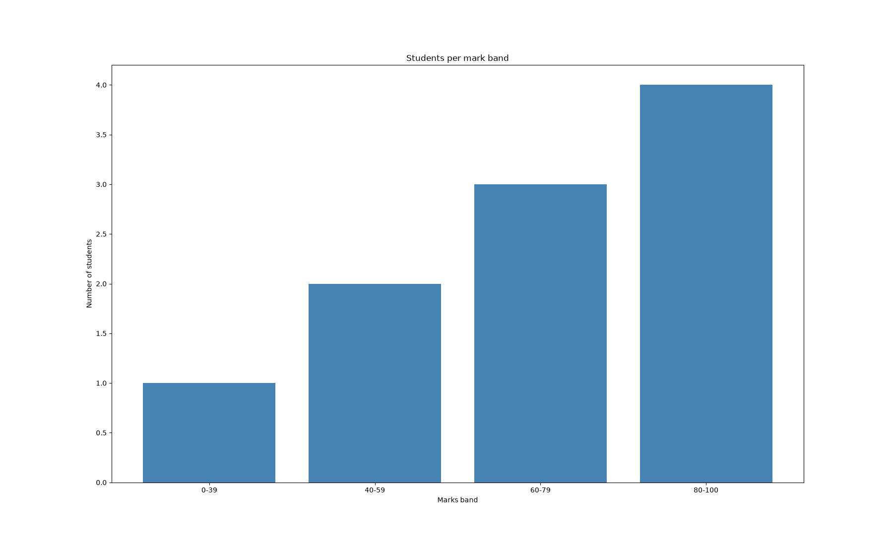

# Result Statistics Analyzer




Reads student marks from a CSV file and prints the class statistics, pass percentage and a bar chart of mark bands. It runs from the terminal with a simple menu.

## Features

- Mean, median, mode, highest, lowest and standard deviation (`np.std`)
- Pass percentage (pass mark is 40)
- Count of students in each band: 0-39, 40-59, 60-79 and 80-100
- Bar chart of the mark bands (opens in a separate window)
- Skips missing marks and marks outside 0-100, with a warning for each one
- Shows a message if `results.csv` is missing

## Input format

`results.csv` needs two columns, `RollNo` and `Marks`:

```csv
RollNo,Marks
1,45
2,56
3,67
```

## How to run

1. Install the libraries: `pip install pandas numpy matplotlib`
2. Keep `result_analyzer.py` and `results.csv` in the same folder.
3. Run the script: `python result_analyzer.py`

## Sample output

```
1. Show statistics
2. Pass percentage and distribution
3. Exit
Enter choice: 1
Students: 10
Mean: 70.00
Median: 72.00
Mode: 72
Highest: 95 | Lowest: 38
Standard deviation: 17.92
```

```
Enter choice: 2
Passed: 9 | Failed: 1 | Pass percentage: 90.00%
0-39 : 1
40-59 : 2
60-79 : 3
80-100 : 4
```

## Project structure

```
result-statistics-analyzer/
├── result_analyzer.py
├── results.csv
└── README.md
```

## Built with

Python 3, Pandas, NumPy, Matplotlib
